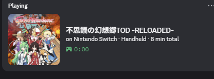
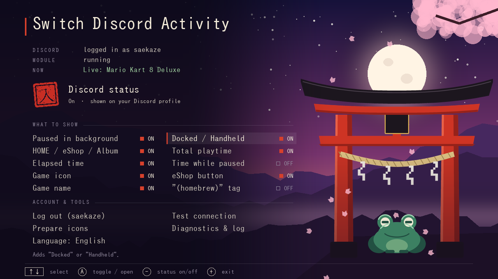
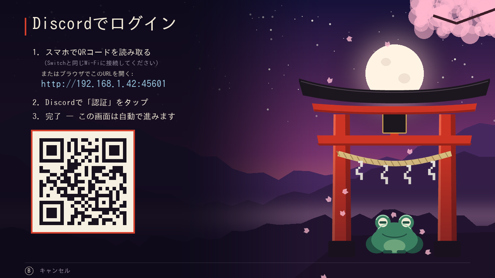

# Switch Discord Activity

Discord Rich Presence for a modded Nintendo Switch, **with no PC**. The console sets your Discord status by itself: log in once with your phone, and from then on Discord shows what you play.



Based on [llsc12/SwitchRPC](https://github.com/llsc12/SwitchRPC). See [what's different](#differences-from-llsc12switchrpc).

## Features

- **Name** read from the game itself, in the console's language.
- **Icon:**
  - official icon from the eShop (or tinfoil);
  - forwarders and installed homebrew get their **own** icon, uploaded once;
  - `.nro` from the Homebrew Menu shows as *Homebrew*.
- **Elapsed time** starts right away, even when the console clock is wrong.
- **Paused when the game isn't in front.** HOME Menu, eShop, user page, sleep mode → `Paused · HOME Menu · 1:23:45`, and the timer stops.
- **No game open:** shows `HOME Menu`, `Nintendo eShop`, `Album`… (optional).
- **Extras:**
  - Docked / Handheld;
  - total playtime;
  - an *eShop* button with the game's store page.
- **Settings for every part**, plus a one-button off switch, in the app **and in the Tesla overlay menu** (change them in-game).
- **Battery saver:** the module stays fully idle while the console sleeps.
- **Updates itself:** *Check for updates* in the app installs the newest release from GitHub.
- **App menu** in English and Japanese, with a diagnostics page and a step-by-step Discord test.

## Install

Needs [Atmosphère](https://github.com/Atmosphere-NX/Atmosphere).

1. Download `switch-discord-activity-x.y.z.zip` from [Releases](../../releases). Copy its `atmosphere` and `switch` folders to the root of the SD card. (Not the other files in the release: those are for the in-app updater.)
2. Reboot.
3. Open **Switch Discord Activity** from the Homebrew Menu and choose **Log in with Discord**.
4. Scan the QR code with your phone (same Wi-Fi as the Switch) and tap **Authorize**.

That's it. Start a game, and it shows up on Discord within a few seconds. You don't need to open the app again.

**Updating:** open the app and choose **Check for updates** (the menu also tells you when there's a new version). It downloads the new module, app and overlay from GitHub and restarts the module. From 1.0.0, update once by hand with the zip.

> **From 1.1.0 - 1.1.3 to 1.1.4 or newer: restart the console.** Those versions can't replace the app while it's open, so *Check for updates* may end with "Couldn't replace ... .nro". That's expected: restart the console and the new background module finishes the update. Then open the app and *Check for updates* once more to add the overlay.

**Not showing up?** In Discord, open *Settings → Activity Privacy* and turn on sharing your activity.

## The menu



| | |
|---|---|
| **Seal 入 / 切** | the whole status on or off. **−** switches it from anywhere in the menu |
| Paused in background | game open but you're in the HOME Menu, eShop…: show it as paused (off: hide) |
| HOME / eShop / Album | no game open: show the screen you're on (off: show nothing) |
| Elapsed time | the timer |
| Game icon | the game's icon |
| Game name | off: only `Nintendo Switch · Playing a game`: no name, icon or button |
| Docked / Handheld | `· Docked` / `· Handheld` |
| Total playtime | `· 152 h total`, from the console's own play statistics |
| Time while paused | the time played so far on the paused status |
| eShop button | a button to the game's eShop page (games the eShop lists) |
| "(homebrew)" tag | `(homebrew)` after forwarders and other non-eShop titles |
| Battery saver | sleep: clear the status and keep the module completely idle until the console wakes up; on battery, check every 5 s instead of 2 s. Off by default |

The app also has:
- **Test connection** — sends a test status and shows Discord's answer for each step;
- **Prepare icons** — uploads all forwarder icons at once, as a backup. It asks first: *new titles only* (titles installed since last time, plus icons whose link stopped working) or *from scratch* (everything again);
- **Diagnostics & log** — versions, module state, the log;
- **Check for updates** — installs the newest release.

Settings are saved to `sdmc:/config/switchrpc.ini`. The module picks them up within a couple of seconds, no reboot needed.

### Overlay

With [nx-ovlloader](https://github.com/WerWolv/nx-ovlloader) and [Tesla Menu](https://github.com/WerWolv/Tesla-Menu) (or [Ultrahand](https://github.com/ppkantorski/Ultrahand-Overlay)) installed, **Discord Activity** appears in the overlay menu (L + D-pad down + R3 by default). It has every switch from the app, plus who's logged in, whether the module runs and what Discord shows right now. Logging in, icons and updates stay in the app.

The module's on/off switch in ovl-sysmodules still works too: it starts and stops the module itself.



## Differences from llsc12/SwitchRPC

This project started from [llsc12/SwitchRPC](https://github.com/llsc12/SwitchRPC) (MIT). The background module is that project's C++ sysmodule, heavily extended, and the login uses the same Discord Social SDK OAuth flow. The app was rewritten from scratch.

| | llsc12/SwitchRPC | Switch Discord Activity |
|---|---|---|
| **Where requests go** | `discord.com` (times out on networks that block it) | everything through `gaming-sdk.com`, Discord's Social SDK API host |
| **Second line** | `Nintendo Switch` | `on Nintendo Switch`, optionally `· Docked`, `· 152 h total` |
| **Unknown titles / forwarders** | a tinfoil link, broken if tinfoil has no icon | tinfoil is checked first; otherwise the title's own icon is uploaded once and cached |
| **`.nro` from the Homebrew Menu** | not shown | `Homebrew` |
| **Album** | — | real album (`Album`) told apart from hbmenu, which also runs as the album |
| **Game in the background** | keeps showing as playing | `Paused · HOME Menu · 1:23:45`, timer stops and resumes where it left off |
| **No game open** | nothing | HOME Menu, eShop, user page, Album… (optional) |
| **Sleep** | status removed | `Paused · sleep mode`; the timer continues after waking. Or, with battery saver, removed and the module stays idle |
| **Power off / reboot** | status lingers until Discord drops it | removed right away |
| **Wrong console clock** (common on modded consoles) | timer appears minutes late | start time corrected with Discord's clock |
| **Switching games** | up to 10 s, plus icon lookups before anything is posted | checked every 2 s; posted at once, icon added after |
| **Changing the status** | updates the session in place, so Discord kept the old timer and image | old session deleted, new one created |
| **Failed post** | next try at the next game switch or after 15 min | retried every 30 s; on 401 the token is refreshed |
| **Name not in the console's language** | no status | name taken from another language |
| **eShop button** | — | optional |
| **Settings** | — | 11 toggles + master switch, in the app and in a Tesla overlay |
| **No internet** | the module waits for the network and does nothing else | keeps running, posts as soon as the connection is back |
| **App** | Embedded Swift, text console: log in / log out | C + SDL2 menu in English / 日本語, QR code on screen, diagnostics, Discord test, icon preparation, self-update from GitHub |
| **Log** | tokens written to the SD card log | tokens never logged |

Shared with the original, on purpose:
- **Login infrastructure.** The Discord application (`1249119754522857616`) and the login bounce page `static.llsc12.me/discord` both belong to llsc12.
- **Module id** `3120000000000092`. Installing this replaces the original instead of running two presence modules.
- **Token file** `sdmc:/config/switchrpc_token`. If you were logged in with the original, you stay logged in.

All of these are set in [`include/config.h`](include/config.h). A fork with its own Discord application changes them there.

## Privacy

- **Login.** It goes through Discord's own authorization page. llsc12's static page only passes the one-time code from your phone back to the console. The token's scope is **presence only** (`sdk.social_layer_presence`): no messages, no servers.
- **Token on the SD card.** The refresh token is stored in `sdmc:/config/switchrpc_token`. Anyone with your SD card can set your Discord status (nothing more). *Log out* in the app deletes it.
- **Uploaded icons are public.** Forwarder icons are uploaded to catbox.moe (or freeimage.host as a fallback), because Discord only shows images by URL. Only the icon image is sent. Hosts can delete files, so saved links are checked and a dead one is uploaded again.
- **No certificate checks.** Like the original, the console doesn't verify TLS certificates for these requests: its certificate store can't verify these hosts.
- **Update check.** When the app opens, it asks `api.github.com` for the latest release (nothing about you is sent). Downloaded updates are checked against the release's `SHA256SUMS`, which catches broken downloads; since certificates aren't verified, it doesn't protect against someone who controls your network.

## Troubleshooting

Open **Diagnostics & log** in the app. It shows whether the module is installed and running, whether you're logged in, what was last sent to Discord (and Discord's answer if it failed), the icon URL, the clock offset and the log. **Test connection** runs the module's requests step by step.

| Seen | Meaning |
|---|---|
| `Discord said HTTP 401` / `login expired` | log out and in again |
| `Can't reach Discord: Timeout` | no internet, or a network that blocks Discord |
| `2001-0132` when starting the module | it's already running; just reboot |

The module log is `sdmc:/switchrpc_log.txt`.

## Building

You need [devkitPro](https://devkitpro.org/wiki/Getting_Started) with these packages:

```sh
dkp-pacman -S switch-dev switch-curl switch-libjson-c switch-sdl2 switch-sdl2_ttf switch-sdl2_image
make dist        # -> out/switch-discord-activity-<version>.zip, plus the updater files and SHA256SUMS
```

The rest of the repo:
- `sysmodule/` — background module (C++). Posts Discord headless sessions.
- `overlay/` — the Tesla overlay (C++, [libtesla](https://github.com/WerWolv/libtesla), vendored in `overlay/libs/`).
- `include/settings.h` — the settings, shared by the app and the overlay.
- `app/` — the app (C, SDL2):
  - `app/art/make_art.py` draws the background, torii, frog, seals and petals into `app/romfs/` (needs `fonts-ipafont-mincho` for the seals);
  - `app/tools/preview.c` renders the menu on a PC.
- `include/config.h` — version, module id, Discord app id, login page.

**Making a release:**
1. Bump `SWITCHRPC_VERSION` in `include/config.h` and add a `CHANGELOG.md` entry.
2. Push to `main` (or push a tag `vX.Y.Z`).

If that version isn't released yet, GitHub Actions builds the zip and publishes the release, with `exefs.nsp`, the `.nro`, the `.ovl` and `SHA256SUMS` next to it for the in-app updater.

## Credits

- [llsc12/SwitchRPC](https://github.com/llsc12/SwitchRPC) by Lakhan Lothiyi (MIT): the original sysmodule, the Discord Social SDK approach and the login flow, which credits NXGallery and SwitchPresence-Rewritten.
- [switchbrew/libnx](https://github.com/switchbrew/libnx), [devkitPro](https://devkitpro.org).
- [QR Code generator library](https://github.com/nayuki/QR-Code-generator) by Project Nayuki (MIT).
- [libtesla](https://github.com/WerWolv/libtesla) by WerWolv (GPL-2.0) for the overlay.
- The *Homebrew* image is the [nx-hbmenu](https://github.com/switchbrew/nx-hbmenu) icon, linked from switchbrew's repository.
- More third-party components are listed in [THIRD_PARTY_NOTICES.md](THIRD_PARTY_NOTICES.md).

Not affiliated with Nintendo or Discord. Uses Discord endpoints the way the Discord Social SDK does. Use at your own risk.

## License

MIT, see [LICENSE](LICENSE). The overlay binary includes libtesla and is therefore distributed under GPL-2.0-or-later; see [THIRD_PARTY_NOTICES.md](THIRD_PARTY_NOTICES.md).
