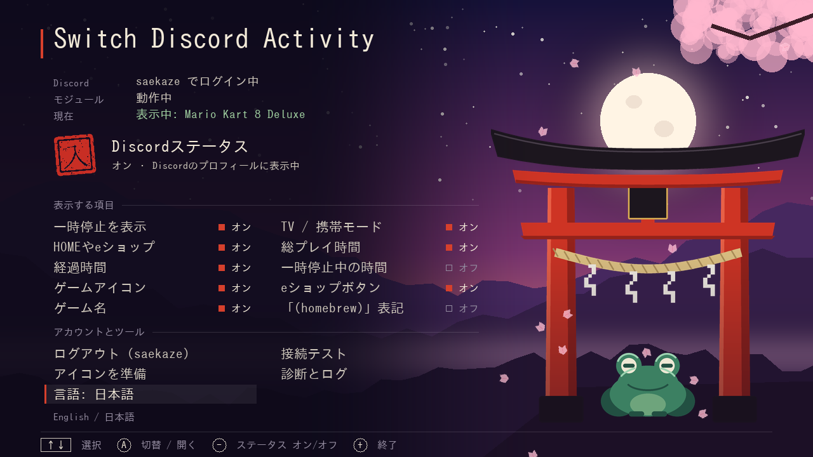

# Switch Discord Activity

Discord-статус для прошитого Nintendo Switch, **без ПК**. Консоль сама ставит статус в Discord: один раз входишь через телефон, и дальше Discord показывает, во что ты играешь.

> **Играет в Mario Kart 8 Deluxe**
> on Nintendo Switch · Docked · 152 h total
> 01:23:45



Основан на [llsc12/SwitchRPC](https://github.com/llsc12/SwitchRPC). Чем отличается — [ниже](#чем-отличается-от-llsc12switchrpc).

[English](README.md)

## Возможности

- **Название** берётся из самой игры, на языке консоли.
- **Иконка:**
  - официальная из eShop (или tinfoil);
  - у форвардеров и установленного хоумбрю — **своя** иконка, загружается один раз;
  - `.nro` из Homebrew Menu показывается как *Homebrew*.
- **Время игры** идёт сразу, даже если часы консоли сбиты.
- **Пауза, когда ты не в игре.** HOME-меню, eShop, профиль, сон → `Paused · HOME Menu · 1:23:45`, таймер стоит.
- **Без игры:** показывает `HOME Menu`, `Nintendo eShop`, `Album`… (по желанию).
- **Дополнительно:**
  - док / портатив;
  - общее время в игре;
  - кнопка со страницей игры в eShop.
- **Каждую часть можно отключить**, а весь статус выключается одной кнопкой.
- **Меню приложения** на английском и японском, с диагностикой и пошаговым тестом Discord.

## Установка

Нужна [Atmosphère](https://github.com/Atmosphere-NX/Atmosphere).

1. Скачай `switch-discord-activity-x.y.z.zip` в [Releases](../../releases) и скопируй папки `atmosphere` и `switch` из него в корень SD-карты.
2. Перезагрузи консоль.
3. Открой **Switch Discord Activity** в Homebrew Menu и выбери **Log in with Discord / Discordでログイン**.
4. Отсканируй QR-код телефоном (телефон в той же Wi-Fi сети) и нажми «Авторизовать».

Готово. Запусти игру — через несколько секунд она появится в Discord. Приложение больше открывать не нужно.

**Не видно?** Discord → Настройки → Конфиденциальность активности → включи «Делиться активностью».

## Меню

| | |
|---|---|
| **Печать 入 / 切** | весь статус вкл/выкл. Кнопка **−** с любого места в меню |
| Paused in background | игра свёрнута → показать паузу (выкл: скрыть) |
| HOME / eShop / Album | без игры: показать экран, на котором ты сейчас (выкл: ничего) |
| Elapsed time | таймер |
| Game icon | иконка игры |
| Game name | выкл: только `Nintendo Switch · Playing a game`, без названия, иконки и кнопки |
| Docked / Handheld | `· Docked` / `· Handheld` |
| Total playtime | `· 152 h total`, из статистики самой консоли |
| Time while paused | время игры в статусе паузы |
| eShop button | кнопка со страницей игры в eShop (только у игр из eShop) |
| "(homebrew)" tag | пометка `(homebrew)` у форвардеров |

Ещё в приложении:
- **Test connection** — отправляет тестовый статус и показывает ответ Discord на каждом шаге;
- **Prepare icons** — загружает иконки всех форвардеров сразу (запасной вариант);
- **Diagnostics & log** — версии, состояние модуля, лог.

Настройки хранятся в `sdmc:/config/switchrpc.ini`. Модуль подхватывает их за пару секунд, перезагрузка не нужна.

## Чем отличается от llsc12/SwitchRPC

Проект начался с [llsc12/SwitchRPC](https://github.com/llsc12/SwitchRPC) (MIT). Фоновый модуль — это его C++-модуль, сильно доработанный, а вход сделан так же, через OAuth Discord Social SDK. Приложение написано заново.

| | llsc12/SwitchRPC | Switch Discord Activity |
|---|---|---|
| **Куда идут запросы** | `discord.com` (где он заблокирован, например в России, — таймаут) | всё через `gaming-sdk.com`, API-домен Discord Social SDK |
| **Вторая строка** | `Nintendo Switch` | `on Nintendo Switch`, по желанию `· Docked`, `· 152 h total` |
| **Неизвестные тайтлы и форвардеры** | ссылка на tinfoil, битая, если там нет иконки | tinfoil проверяется; иначе своя иконка тайтла, загруженная один раз |
| **`.nro` из Homebrew Menu** | не показывается | `Homebrew` |
| **Альбом** | — | настоящий альбом (`Album`) отличается от hbmenu, хотя hbmenu тоже запускается как альбом |
| **Игра свёрнута** | продолжает показываться как игра | `Paused · HOME Menu · 1:23:45`, таймер стоит и продолжается с того же места |
| **Игра не запущена** | ничего | HOME Menu, eShop, профиль, Album… (по желанию) |
| **Сон** | статус удаляется | `Paused · sleep mode`, после пробуждения таймер продолжается |
| **Выключение и перезагрузка** | статус висит, пока Discord сам не уберёт | убирается сразу |
| **Сбитые часы консоли** (частое дело на прошитых) | таймер появляется через несколько минут | время старта сверяется с часами Discord |
| **Смена игры** | до 10 с плюс поиск иконки, только потом отправка | проверка каждые 2 с; статус уходит сразу, иконка добавляется следом |
| **Обновление статуса** | на месте — Discord оставлял старый таймер и картинку | старая сессия удаляется, создаётся новая |
| **Неудачная отправка** | следующая попытка при смене игры или через 15 мин | повтор каждые 30 с; при 401 токен обновляется |
| **Нет названия на языке консоли** | статуса нет | берётся название на другом языке |
| **Кнопка eShop** | — | по желанию |
| **Настройки** | — | 10 переключателей + общий выключатель |
| **Приложение** | Embedded Swift, текстовая консоль: вход и выход | C + SDL2, меню на English / 日本語, QR-код на экране, диагностика, тест Discord, подготовка иконок |
| **Лог** | токены пишутся в лог на SD | токены в лог не пишутся |

Общее с оригиналом, специально:
- **Инфраструктура входа.** Discord-приложение (`1249119754522857616`) и страница-прослойка `static.llsc12.me/discord` принадлежат llsc12.
- **ID модуля** `3120000000000092`. При установке он заменяет оригинал, и два модуля статуса не работают одновременно.
- **Файл токена** `sdmc:/config/switchrpc_token`. Если ты входил в оригинале, вход сохранится.

Всё это задаётся в [`include/config.h`](include/config.h). Форк со своим Discord-приложением меняет это там.

## Приватность

- **Вход.** Идёт через страницу авторизации самого Discord. Статическая страница llsc12 только передаёт одноразовый код с телефона на консоль. Токен даёт доступ **только к статусу** (`sdk.social_layer_presence`): без сообщений и серверов.
- **Токен на SD-карте.** Refresh-токен лежит в `sdmc:/config/switchrpc_token`. У кого есть твоя SD-карта, тот может менять твой статус (и только его). *Log out* в приложении удаляет токен.
- **Загруженные иконки публичны.** Иконки форвардеров загружаются на freeimage.host (или catbox.moe), потому что Discord показывает картинки только по ссылке. Отправляется только сама иконка.
- **Без проверки сертификатов.** Как и в оригинале, консоль не проверяет TLS-сертификаты этих запросов: её хранилище сертификатов их не проверяет.

## Если не работает

Открой **Diagnostics & log** в приложении. Там видно:
- установлен и запущен ли модуль;
- выполнен ли вход;
- что последним ушло в Discord, и ответ Discord, если не получилось;
- ссылку на иконку и сдвиг часов консоли;
- лог.

**Test connection** проходит запросы модуля по шагам.

| Видно | Значит |
|---|---|
| `Discord said HTTP 401` / `login expired` | выйди и войди заново |
| `Can't reach Discord: Timeout` | нет интернета или сеть блокирует Discord |
| `2001-0132` при запуске модуля | он уже работает, просто перезагрузи консоль |

Лог модуля: `sdmc:/switchrpc_log.txt`.

## Сборка

Нужен [devkitPro](https://devkitpro.org/wiki/Getting_Started) с такими пакетами:

```sh
dkp-pacman -S switch-dev switch-curl switch-libjson-c switch-sdl2 switch-sdl2_ttf switch-sdl2_image
make dist        # -> out/switch-discord-activity-<версия>.zip
```

Что где лежит:
- `sysmodule/` — фоновый модуль (C++);
- `app/` — приложение (C, SDL2):
  - `app/art/make_art.py` рисует фон, тории, лягушку, печати и лепестки (для печатей нужен шрифт `fonts-ipafont-mincho`);
  - `app/tools/preview.c` рисует меню на ПК.
- `include/config.h` — версия, ID модуля, ID Discord-приложения, страница входа.

**Релиз:**
1. Подними `SWITCHRPC_VERSION` в `include/config.h` и добавь запись в `CHANGELOG.md`.
2. Запушь тег `vX.Y.Z`.

GitHub Actions соберёт zip и опубликует релиз.

## Благодарности

- [llsc12/SwitchRPC](https://github.com/llsc12/SwitchRPC), автор Lakhan Lothiyi (MIT): исходный модуль, идея с Discord Social SDK и схема входа (в оригинале благодарность NXGallery и SwitchPresence-Rewritten).
- [switchbrew/libnx](https://github.com/switchbrew/libnx), [devkitPro](https://devkitpro.org).
- [QR Code generator](https://github.com/nayuki/QR-Code-generator), Project Nayuki (MIT).
- Картинка *Homebrew* — иконка [nx-hbmenu](https://github.com/switchbrew/nx-hbmenu) по ссылке на репозиторий switchbrew.
- Остальные сторонние компоненты перечислены в [THIRD_PARTY_NOTICES.md](THIRD_PARTY_NOTICES.md).

Проект не связан с Nintendo и Discord. Использует эндпоинты Discord так же, как Discord Social SDK. Используешь на свой риск.

## Лицензия

MIT, см. [LICENSE](LICENSE).
